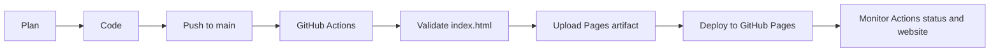

# DevOps Lab 1 — Portfolio & CI/CD

Portfolio tĩnh cho Lab 1: **Trải nghiệm DevOps Workflow End-to-End**. Mã nguồn là HTML/CSS; GitHub Actions kiểm tra file trang rồi triển khai lên GitHub Pages.

## Chạy local

Mở `index.html` trực tiếp trong trình duyệt. Trang không cần cài dependency hay chạy server.

## Pipeline

Push lên `main` hoặc chạy thủ công bằng **Actions → Deploy to GitHub Pages → Run workflow**. Workflow kiểm tra cấu trúc HTML bằng Python standard library, đóng gói site thành Pages artifact và deploy artifact đó.

## DevOps và cách triển khai thủ công

| Tiêu chí | Thủ công | DevOps với CI/CD |
|---|---|---|
| Cách triển khai | Chép file rồi upload/cấu hình trên máy chủ. | Push lên `main`; Actions kiểm tra và deploy. |
| Thời gian | Thường 15–30 phút cho một lần cập nhật nhỏ. | Thường vài phút tính cả thời gian chờ runner; thao tác của người làm là một lần push. |
| Ai triển khai | Người phát triển hoặc người vận hành. | GitHub Actions chạy các bước đã khai báo. |
| Sai sót | Dễ bỏ sót bước hoặc deploy nhầm file; vẫn cần kiểm tra. | Các bước lặp lại nhất quán; lỗi cấu hình hoặc nội dung vẫn có thể làm pipeline thất bại. |
| Rollback | Tải lại bản cũ hoặc khôi phục thủ công. | `git revert <commit>` rồi push; pipeline triển khai lại phiên bản đã khôi phục. |
| Biết kết quả | Kiểm tra server và website thủ công. | Xem trạng thái từng bước và log trong tab Actions; mở URL Pages để kiểm tra. |

### Câu hỏi

1. **Pipeline tự động hóa bước nào?** Sau khi push, Actions tự kiểm tra `index.html`, đóng gói artifact và deploy; người phát triển không cần upload file thủ công.
2. **Nếu website lỗi thì quay lại bản cũ thế nào?** Tạo commit hoàn tác bằng `git revert <commit>` rồi push lên `main`. Pipeline chạy lại trên nội dung đã khôi phục. Cách này giữ lịch sử Git.
3. **Tiết kiệm bao nhiêu thời gian?** So với quy trình chép file, cấu hình và kiểm tra thủ công (ước tính 15–30 phút), thao tác cập nhật còn một lần push. Thời gian chạy toàn pipeline thay đổi theo thời gian khởi động runner và hàng đợi GitHub Actions.

## Bật GitHub Pages

1. Tạo repository public `maiychrus25/devops-lab1-portfolio` và push các file trong thư mục này lên nhánh `main`.
2. Mở **Settings → Pages**, chọn **GitHub Actions** làm publishing source.
3. Mở tab **Actions**, chờ workflow hoàn tất thành công.
4. URL dự kiến: <https://maiychrus25.github.io/devops-lab1-portfolio/>. Chỉ xác nhận website đã hoạt động sau khi mở URL này và thấy trang portfolio.

## Kết quả lab

- Portfolio responsive, chạy bằng HTML/CSS tĩnh.
- Workflow triển khai khi push lên `main` hoặc chạy thủ công.
- Bảng so sánh, sơ đồ DevOps workflow và câu trả lời nằm ngay trong README này.
